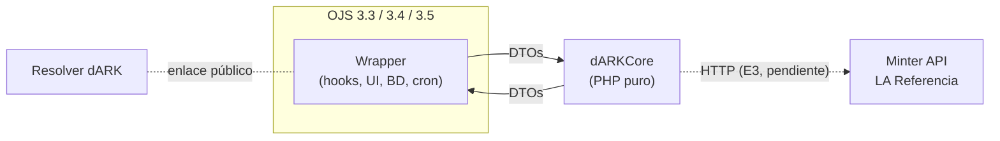

# Arquitectura del plugin

## Idea general
- **dARKCore:** un repo aparte, solo PHP, **sin dependencias de OJS**. Recibe DTOs, procesa y devuelve DTOs. Valida ARK, prefijos y configuración, procesa el CSV y define los estados. Ver [[dARKCore]].
- **Un wrapper por versión de OJS** (3.3, 3.4 y 3.5), cada uno en su rama. Se encarga de los hooks, la persistencia, la interfaz, las traducciones y las tareas programadas. Incluye el core como **submódulo de git**. Ver [[Wrappers OJS 3.3, 3.4 y 3.5]].
- Toda la comunicación la **inicia el plugin** hacia el nodo central de dARK.



## Reparto de responsabilidades

| Core | Wrapper |
|---|---|
| Reglas del ciclo de vida del ARK: validaciones, normalización, estados | Clase principal, registro de hooks y eventos |
| Comunicación con la API de dARK (pendiente) | Persistencia: ARK y estado en la publicación; operaciones pendientes y auditoría en tablas propias |
| Lectura, validación y reporte del CSV | Interfaz: ajustes, importación, asignación, estado, auditoría |
| Definición de los DTOs | Tareas programadas, jobs y lotes |
| | Exposición del ARK: página, HTML y OAI-PMH |
| | Traducciones (es, en, pt_BR) |

## Tipo de plugin
- Plugin de categoría **pubIds** (`plugins/pubIds/dARK`), igual que los de URN y ARK. Por eso OJS expone el ARK solo, en `DC.Identifier.*`, en OAI-PMH y en la pestaña Identificadores.
- Además registra un **subplugin de importación/exportación** para el CSV (Herramientas → Importar/Exportar).
- Tipo de pubId: `other::dark` → campo `pub-id::other::dark` en la publicación.

## Repositorios y ramas

| Repo | URL | Ramas |
|---|---|---|
| Plugin | `git@github.com:sedici/dARK.git` | `stable-3_3`, `stable-3_4`, `stable-3_5` (estables) y `dev-3_3`, `dev-3_4`, `dev-3_5` (desarrollo); `main` solo tiene el commit inicial |
| Core | submódulo `dARKCore/` | `stable-php-7.4` y `dev-php-7.4` |
| Sandbox | `github.com/sedici/ojs-sandbox` | `main` |
| dark-deployer | `github.com/LA-Referencia-IOI/dark-deployer` | Sin acceso desde octubre; copia local del 24/09 |

**Tags:** `e1-ojs3.3`, `e1-ojs3.4`, `e1-ojs3.5` (plugin) y `e1` (core). La Entrega 2 no tiene tag todavía; ver [[Deuda técnica]].

**Política de versiones (plan):** en cada entrega, las tres ramas del plugin apuntan al **mismo tag del core**. Si alguna vez conviene usar PHP 8, se abre una rama del core por versión de PHP.

## Workspace local
```text
~/SEDICI/dARK-LAReferencia/
├── dark-pubid-plugin/   clon del plugin (main)
├── dark-worktrees/      worktrees: ojs33 → dev-3_3, ojs34 → dev-3_4, ojs35 → dev-3_5
├── ojs-sandbox/         Docker con OJS 3.3, 3.4 y 3.5 y MySQL 8
└── dark-deployer/       copia de la plataforma dARK (referencia de la API)
```
Ver [[¿Cómo usar?|Sandbox]] y [[Propuesta Commits]] para el flujo de trabajo.
